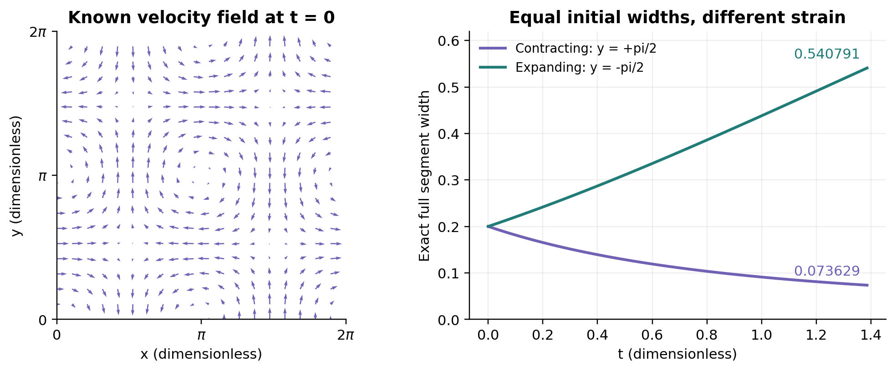

# Vortex-Thread Motion

A Research Framework for Particle Collection and Motion Compression

Aaron Michael Weis | OneiroNexus
ORCID: 0009-0002-1906-148X
Research edition 1.0.0 | November 26, 2026

### Abstract

Can organized motion help gather particles, and can a compact description of that motion reduce the data needed to reconstruct it? Vortex connects these questions while requiring separate physical and coding tests. This edition supplies supporting checks: a known two-dimensional Taylor-Green solution, passive trajectories with exact segment-width references, and reversible compression baselines on five external velocity fixtures. All 18 packets reconstruct their canonical binary64 targets exactly; plain XZ gives the smallest packets in this panel. Recovered original programs also reproduce 117,676,800 bytes of authored geometry against separate reference calculations, with platform-dependent floating-point bytes. These are verification and procedural-replay results. They do not demonstrate particle capture, physical fluid-volume compression, a successful flow-based compressor or arbitrary-video compression. A prescribed donut-shaped morph illustrates the proposal without validating a physical mechanism. The paper specifies separate particle-retention and held-out coding tests, and explains how one physical trajectory dataset could eventually support both.

### What this edition contributes

The contribution is a transparent research package: an independently checked derivation, executable numerical diagnostics, bit-exact baseline coding, source-linked figures, and explicit boundaries between completed checks and proposed experiments. The Taylor-Green field and predictive residual coding are established methods [1,7-10]. This paper makes no new-solution or codec-priority claim.

### Two hypotheses, separate evidence

The physical hypothesis is that a specified flow and collector can gather and retain particles. The coding hypothesis is that a compact motion model plus exact corrections can beat strong baselines on independent data. Organized motion connects them; success on either test does not prove the other. Both application claims remain untested here.

Code, numerical reports, figures and this manuscript are versioned together. AI assistance is disclosed in section 7. Paper and original figures: CC BY 4.0. Original code: MIT. This technical preprint has internal computational review; no independent human peer review is claimed.

---

## 1. The exact field

Use dimensionless coordinates on the periodic square [0, 2π)², unit density, constant kinematic viscosity ν ≥ 0, and no forcing. Pressure is kinematic pressure. The equations and chosen stream-function convention are

∂ₜu + (u · ∇)u = -∇p + νΔu,       ∇ · u = 0,
ψ = A(t) cos x cos y,       u = (-∂ᵧψ, ∂ₓψ).

Writing u = (u₁,u₂) gives the velocity and a zero-spatial-mean pressure:

u = A(t)(cos x sin y, -sin x cos y),
p = -A(t)²[cos(2x) + cos(2y)]/4.                                  (1)

An arbitrary spatially constant C(t) can be added to p. Direct differentiation gives ∂ₓu₁ = -A sin x sin y and ∂ᵧu₂ = A sin x sin y, so divergence vanishes. The velocity Laplacian is Δu = -2u. The convective term and pressure gradient are

(u · ∇)u = -(A²/2)(sin 2x, sin 2y),
∇p = (A²/2)(sin 2x, sin 2y).                                      (2)

The nonlinear term is canceled by -∇p. The remaining equation is A′ = -2νA. Taking A(0) = 1 gives A(t) = exp(-2νt). This derives the known field in the phase convention used here. It neither introduces a new Navier-Stokes solution nor proves the accuracy of an unrelated numerical solver [1].

### Invariants, strain and normalization

For passive paths, dX/dt = u(X,t), the scalar q(x,y) = cos x cos y obeys u · ∇q = 0. Its value stays constant along an exact path, although ψ = A(t)q changes with time when ν > 0. The vorticity is ω = ∂ₓu₂ - ∂ᵧu₁ = -2A cos x cos y.

E = mean(|u|²)/2 = A²/4,       Z = mean(ω²)/2 = A²/2,
dE/dt = -4νE = -2νZ.                                              (3)

Here mean denotes a spatial mean. Domain-integrated energy and enstrophy multiply these values by 4π². The symmetric strain tensor is diag(-A sin x sin y, A sin x sin y), with zero trace. Material deformation F satisfies F′ = (∇u)F and det F = 1 in the exact flow. Directional stretching can therefore coexist with area preservation.

---

## 2. A segment with a known answer

Start two horizontal segments with endpoints x = π/2 ± δ₀, using δ₀ = 0.10. Put one at y = +π/2 and the other at y = -π/2 (equivalently 3π/2). Their centers are stationary. On these lines the transverse velocity vanishes, while the positive endpoint half-width contracts or expands according to

dδ/ds = -sin δ  at y = +π/2;     dδ/ds = +sin δ  at y = -π/2,
s(t) = ∫₀ᵗ A(r)dr = [1 - exp(-2νt)]/(2ν)  for ν > 0;  s = t for ν = 0.

Separating variables yields exact full widths. Coordinates are kept unwrapped so that crossing a periodic display seam does not create a false length jump.

L±(t) = 4 arctan[tan(δ₀/2) exp(±s(t))].                          (4)

For ν = 0.25 and t = 2 ln 2, A = 0.5 and s = 1. The initial widths are both 0.20; the contracting width is 0.0736289459135128 and the expanding width is 0.5407906651876966. The signs and values were independently recalculated in this review.

Figure 1. Left: samples of the exact field, not a numerical PDE solution. Right: the closed-form segment widths at ν = 0.25. Curves come from equation (4); the initial geometry and all units are dimensionless.

### What a visible thread represents

These segments are material curves transported by the in-plane velocity. They are not vortex lines: this two-dimensional field has vorticity normal to the plane. A short line can contract while nearby directions expand. Neither this demonstration nor a prescribed three-dimensional morph establishes physical creation of a hole.

---

## 3. Fresh numerical verification

The harness checks the known field, parameter boundaries, passive RK4 paths, deformation and reversible coding. Twenty unittest methods and eight separately counted numerical checks passed on Windows (Python 3.12.14, NumPy 2.3.5). The saved report includes sample points and thresholds.

Figure 2. Pointwise centered-difference diagnostics at ν = 0.25 and t = 0.7 (four stated points), with h = dt. The right panel compares exact segment widths and generic paths against an 8,192-step RK4 reference. The latter reference shares the integrator and is not an exact generic trajectory.

| At 64 RK4 steps | Maximum absolute error |
| --- | --- |
| Contracting exact width | 5.278e-11 |
| Expanding exact width | 3.663e-10 |
| Generic paths vs refined RK4 | 4.860e-10 |
| First-integral drift | 1.700e-10 |
| Material det F minus 1 | 6.137e-10 |

Halving h from 0.20 through 0.025 reduced the maximum sampled momentum residual from 5.08×10⁻³ to 8.00×10⁻⁵, with orders 1.991, 1.998 and 1.999. Exact-segment errors approached fourth order over 8, 16, 32 and 64 RK4 steps. Invariant and deformation errors met the 10⁻⁸ thresholds at 64 steps.

Finite-difference divergence is particularly small because this field and matched centered stencils cancel algebraically. That value alone is not a broad solver-quality metric. A wrong-pressure negative control was detected. The command refuses an existing output directory and fails when checks are skipped.

Evidence boundary: this is verification of field evaluation, derivative stencils and trajectory integration. No velocity/pressure PDE discretization is evolved. A future CFD implementation must demonstrate its own spatial and temporal refinement, stability, boundary handling and conservation.

---

## 4. A byte-exact snapshot control

Five TSI Insight .vec fixtures were fetched from a fixed PIVPy commit [6]. Git blob identities and SHA-256 hashes were verified. Each file contains 3,969 rows and five numeric columns: X, Y, U, V and CHC. Parsing these 99,225 tokens as C-order little-endian binary64 gives 793,800 bytes. A velocity-only target gives 317,520 bytes. Headers and original decimal spelling are excluded; signed zero is retained. No CHC filtering is applied.

The reversible transforms are none, XOR with the same point in the previous file, and XOR with the previous point in each file. The first file or point is stored without a predecessor. XOR acts on uint64 representations, not on floating-point differences. Sequential XOR inversion exactly recovers each target word, including special IEEE-754 bit patterns tested separately.

| Target / codec | No transform | Prior-file XOR | Prior-point XOR |
| --- | --- | --- | --- |
| All columns / gzip | 337,927 | 314,186 | 347,471 |
| All columns / bz2 | 201,120 | 292,438 | 321,258 |
| All columns / lzma | 165,896 | 271,401 | 289,362 |
| Velocity / gzip | 219,464 | 273,189 | 285,399 |
| Velocity / bz2 | 161,457 | 275,800 | 289,256 |
| Velocity / lzma | 147,460 | 258,881 | 278,750 |

Table 2. Complete packet bytes, including magic, dimensions, type/order, transform, checksum and compressed body. Gzip uses level 6, bz2 level 9 and XZ/LZMA preset 6. Shared decoder and runtime are excluded consistently. The raw targets differ and should not be compared as equivalent payloads.

Figure 3. Zero-based packet-size comparison from the saved JSON. All 18 packets decoded byte-for-byte. An independent standard-library checker reconstructed both targets directly from the source fixtures and separately decoded every packet.

---

## 5. What the results mean

### The simplest transform did not win generally

XZ without an XOR transform produced the smallest packet for both targets: 165,896 bytes for all columns and 147,460 bytes for velocity alone. Previous-file XOR reduced gzip size by 7.03% on all columns, but worsened every velocity-only comparison. Repeated spatial coordinates and CHC values affect the all-column result. These observations argue for comparing a proposed predictor with several fair baselines rather than assuming that motion structure must improve a compressor.

The fixtures are ordered by filename. Their acquisition headers do not establish the time between files. Previous-file XOR is therefore a file-order baseline, not a demonstrated temporal predictor. The velocity values are unfiltered: CHC counts across the five files are -1: 1,462; 1: 17,954; and -3: 429. This experiment tests a defined numeric representation, not a quality-screened physical flow reconstruction.

### Prior art and the remaining compression question

Predictive floating-point coding predates this work. FPC uses prediction and XOR residuals [7]; Gorilla, Chimp and Elf offer complementary approaches [8-10]. Those specialized codecs were not run in this edition. The measured panel cannot establish superiority over them. Ordinary floating-point subtraction and addition do not guarantee bit-exact recovery; a flow predictor must define deterministic prediction bits and reversible residuals, or explicitly count corrections for platform differences.

### The authored morph and physical clouds

Two additional source archives supplied during review recovered the original programs and demonstration videos. The renderer prescribes a sphere-chart-to-torus shape map while advecting chart coordinates in a Taylor-Green field. Initially distinct chart points can occupy the same physical position and later separate. This is not a single-valued material flow on the initial sphere. Section 6 reports the recovered procedural replay separately from the external-fixture experiment.

For a smooth velocity field with unique trajectories, the finite-time flow map is invertible. It preserves the topology of an intact embedded material surface. A thresholded particle-concentration envelope is a different object and can develop an apparent opening as particles redistribute. Settling-cloud experiments [2-4] motivate a future physical comparison, but their mechanisms and parameters do not validate a prescribed shape map. Dagan’s low-Stokes particle solutions [5] offer a possible intermediate benchmark under their own assumptions.

---

## 6. Recovered original demonstrations

### A recipe for geometry the author already defined

The recovered recipe generates 240 frames with two panels, each containing 71 threads sampled at 141 points and 204 tracers. Coordinates are stored as C-order XYZ little-endian binary64 triples, before camera projection or styling. The target length is 240 × 2 × (71 × 141 + 204) × 3 × 8 = 117,676,800 bytes. It contains geometry, not video pixels, audio or an MP4 container.

The original decoder and a separate extraction of the preserved renderer mathematics generated identical full byte streams in the fresh Windows run. Rendering-only PIL imports and font initialization were omitted; numerical functions and initialization were retained. Changing the recipe seed changes the generated stream, and a one-bit target alteration is detected by SHA-256. The unchanged recipe does not reproduce arbitrary alterations of the authored target.

### Count the shared decoder and the platform

| Representation | Bytes |
| --- | --- |
| Reconstructed coordinate stream | 117,676,800 |
| gzip level 6, fresh Windows stream | 75,882,403 |
| Recipe JSON | 177 |
| Recipe and original decoder source | 2,916 |
| Recipe and decoder, two-entry ZIP | 1,597 |

The two-entry ZIP includes recipe, Python decoder and ZIP overhead. Python, NumPy, mathematical libraries and their compatible floating-point behavior are external requirements. This is not a self-contained 1,597-byte executable or a general-purpose compression ratio.

Fresh Ubuntu CI reproduced the archived Linux checksum and the 75,882,043-byte gzip result. Windows CI matched the local Windows stream, whose gzip result is 360 bytes larger. Both platforms passed full native reference/decoder comparison. The checker separates native agreement from historical agreement: matching a reference on one platform does not establish identical bytes across platforms. Full hashes, environments and linked CI evidence are supplied with the code.

### Viewers and their evidence limits

The original Inkline field checks, passive-segment verifier and Torus viewer DOM-test-double checks passed again. The Torus viewer uses a reduced, rounded trace: 60 frames and 11,520 XYZ triples. It is not the full-precision 240-frame stream. The original videos were recovered and preserved as source evidence; visual appearance alone cannot verify fluid dynamics or compression. See docs/ORIGINAL-DEMONSTRATIONS.md for provenance, tests and remaining limits.

---

## 7. Two separate tests, one connection

### Test A: measurable particle collection

Begin by reproducing a documented settling-cloud case [2] with its actual forces and initial conditions; a driven-flow case [4] is a later comparison. Then specify a collector, particle properties, inflow and retention interval. Measure retained inlet-particle mass divided by admitted particle mass after a stated washout period. Count retained, discharged and circulating particles separately, with a mass balance and no double counting. Compare controls under stated throughput and energy conditions, including pumping and gravity. A ring alone is not collection. Initially uniform passive tracers remain uniform in source-free incompressible flow; capture requires boundaries, removal, particle slip or other specified physics. No collection experiment was performed here.

### Test B: compact reconstruction of independent motion

Use independently produced motion and hold out whole runs before choosing or tuning the predictor. Freeze canonical bytes, particle IDs, timestamps, masks and layout. Compare flow prediction with raw coding, general-purpose codecs, previous-value and spatial baselines, and pinned specialized codecs such as FPC and Chimp128. Give baselines equivalent preprocessing and count reordering maps.

Count initialization, model parameters, residuals, resets, corrections, masks and headers. Require exact decoded bytes before comparing file sizes. Report shared runtime, encoding/decoding time, peak process memory and failures. Current timing samples cover resident-packet decoding, inverse transform and checksum, with five repetitions after preflight and warmup; traced Python allocation is not whole-process memory.

The connection is a shared trajectory record: a validated collection experiment could supply the independent data for Test B. Collection efficiency and coding savings must still be reported separately. Neither the current scripted morph nor replay of self-authored coordinates answers either application test.

### Reproduce this edition

python -m pip install -r requirements.txt
python tools/verify.py --output results/my-verification
python tools/fetch_reference_data.py --output .reference-data
python tools/benchmark_compression.py --data .reference-data --output results/my-compression
python tools/independent_compression_check.py --data .reference-data --results results/my-compression

Fresh output directories are required. requirements-build.txt and tools/build_figures.py / tools/build_paper.py rebuild the figures and manuscript. README and REVIEW_STATUS identify exact release evidence and CI status.

Authorship and review: Aaron Michael Weis is the author. AI assistance supported drafting, programming, literature lookup and internal review. Three specialist passes and an integrating pass checked bounded claims; this is not independent human peer review. Sources retain their authorship. Publication does not establish the untested physical or compression hypothesis.

---

## References

Targeted source review conducted November 26, 2026. This is a bounded literature check, not an exhaustive novelty search. The 2011 settling-cloud source was checked at abstract/metadata level; the other paper references were inspected through publisher or author full text. Third-party articles and raw fixtures are linked, not repackaged.

1. Ondrej Kincl, Ilya Peshkov, Walter Boscheri (2025). [Semi-implicit Lagrangian Voronoi approximation for the incompressible Navier-Stokes equations](https://doi.org/10.1002/fld.5339). International Journal for Numerical Methods in Fluids 97(1), 88-115. Section 5.1.

2. Bloen Metzger, Maxime Nicolas, Elisabeth Guazzelli (2007). [Falling clouds of particles in viscous fluids](https://doi.org/10.1017/S0022112007005381). Journal of Fluid Mechanics 580, 283-301. Published-layout author PDF inspected.

3. Florent Pignatel, Maxime Nicolas, Elisabeth Guazzelli (2011). [A falling cloud of particles at a small but finite Reynolds number](https://doi.org/10.1017/S0022112010005501). Journal of Fluid Mechanics 671, 34-51. Publisher abstract and metadata inspected.

4. Benjamin Marchetti, Laurence Bergougnoux, Elisabeth Guazzelli (2021). [Falling clouds of particles in vortical flows](https://doi.org/10.1017/jfm.2020.883). Journal of Fluid Mechanics 908, A30. Author PDF inspected; figures 4 and 6, Table 4.

5. Yuval Dagan (2025). [Analytical solutions for particle dispersion in Taylor-Green vortex flows](https://doi.org/10.1007/s00162-024-00731-z). Theoretical and Computational Fluid Dynamics 39, article 14. First online December 24, 2024.

6. PIVPy contributors. [TSI Insight demonstration fixtures](https://github.com/alexlib/pivpy/tree/be5e26a17e0d61f7113ec87e98ffcc0d443c297f/pivpy/data/Insight). Five Run000001-Run000005 .vec files; commit be5e26a17e0d61f7113ec87e98ffcc0d443c297f. Retrieved November 26, 2026. Exact source paths and hashes are recorded in the release.

7. Martin Burtscher, Paruj Ratanaworabhan (2009). [FPC: A High-Speed Compressor for Double-Precision Floating-Point Data](https://doi.org/10.1109/TC.2008.131). IEEE Transactions on Computers 58(1), 18-31. Author manuscript and software page inspected.

8. Tuomas Pelkonen et al. (2015). [Gorilla: A Fast, Scalable, In-Memory Time Series Database](https://doi.org/10.14778/2824032.2824078). Proceedings of the VLDB Endowment 8(12), 1816-1827. Sections 4.1.1-4.1.2.

9. Panagiotis Liakos, Katia Papakonstantinopoulou, Yannis Kotidis (2022). [Chimp: Efficient Lossless Floating Point Compression for Time Series Databases](https://doi.org/10.14778/3551793.3551852). Proceedings of the VLDB Endowment 15(11), 3058-3070.

10. Ruiyuan Li, Zheng Li, Yi Wu, Chao Chen, Yu Zheng (2023). [Elf: Erasing-based Lossless Floating-Point Compression](https://doi.org/10.14778/3587136.3587149). Proceedings of the VLDB Endowment 16(7), 1763-1776.
